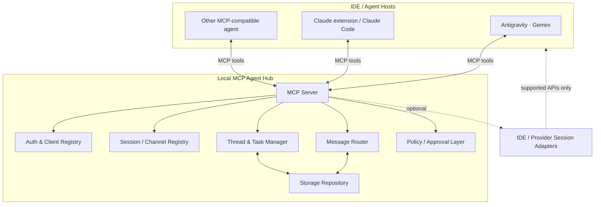

# Local MCP Agent Communication Hub — Implementation Plan

> **Status:** Proposed architecture and implementation plan  
> **Goal:** Build a local Model Context Protocol (MCP) server that lets multiple LLM agents—initially Gemini in Antigravity and Claude through a Claude extension/Claude Code—exchange messages, coordinate work, and review each other's output through explicitly selected sessions.

---

## 1. Executive summary

Build a **local-first MCP communication hub** that exposes a small set of tools to connected agents. The hub manages agent identities, session/channel membership, message delivery, inboxes, conversation threads, and optional coordination workflows.

The MCP server is the **shared communication layer**, not the LLM itself. Each agent remains responsible for deciding when to send a message, how to interpret incoming messages, and what response to produce.

### Initial user experience

1. The user opens a Gemini session in Antigravity and a Claude session/extension.
2. Both clients connect to the local MCP server.
3. The user creates or selects a named project channel/session, e.g. `ipbp-feature-123`.
4. Gemini sends Claude a task or review request.
5. Claude reads its inbox, replies in the same thread, and Gemini retrieves the response.
6. The user remains in control of which sessions are connected and when agents act.

### Important feasibility constraint

MCP standardizes **tool/context exchange between a host and a server**. It does not, by itself, grant a server the ability to inspect or inject messages into another IDE's private conversation.

Therefore, design two layers:

- **MCP communication layer:** portable, implementable first; agents explicitly send/read messages using MCP tools.
- **Session adapter layer:** optional provider/IDE-specific integration to attach to or inject into a live session, only where a supported API or reliable mechanism exists.

The MVP should not depend on undocumented IDE internals.

---

## 2. Goals and non-goals

### Goals

- Local-first operation; messages remain on the user's machine by default.
- Connect multiple MCP-compatible clients/agents.
- Address a specific agent, channel, thread, or task.
- Support asynchronous inbox/outbox communication.
- Preserve message history and traceability.
- Enable request/reply, code review, plan critique, and multi-agent discussion.
- Make agent actions explicit and auditable.
- Provide a foundation for future orchestration and IDE-specific adapters.

### Non-goals for MVP

- Train, fine-tune, or merge models.
- Automatically share entire private conversations between providers.
- Guarantee that an agent will act without its host/client invoking an MCP tool.
- Bypass provider authentication, usage limits, or IDE permissions.
- Automatically execute arbitrary code or commands received from another agent.
- Build a full multi-agent framework with autonomous loops before basic messaging is reliable.

---

## 3. Core concepts

| Concept | Meaning |
|---|---|
| **Agent** | Logical participant, e.g. `gemini-antigravity`, `claude-code` |
| **Client instance** | A concrete running MCP client/IDE connection |
| **Session** | User-defined work context, e.g. `ipbp-feature-123` |
| **Channel** | Message stream within a session, e.g. `architecture-review` |
| **Thread** | A request and its related replies |
| **Message** | Immutable communication item with sender, recipient, content, metadata |
| **Task** | Optional structured request with status, assignee, and result |
| **Adapter** | Provider/IDE-specific mechanism for discovering or interacting with live sessions |

Keep `session_id` distinct from a provider's internal conversation ID. The former is owned by this system; the latter is optional adapter metadata and may not be accessible.

---

## 4. Proposed architecture



### Runtime model

- Run as a local process, initially over **stdio transport** for compatibility with MCP clients.
- Optionally add **Streamable HTTP** for multiple local clients or a local dashboard, protected by authentication.
- Use SQLite for durable message/session state.
- Keep the server stateless between tool calls where practical; persist all important state.
- Use a single local process for MVP to avoid distributed-system complexity.

### Suggested technology stack

- **Language:** TypeScript
- **Runtime:** Node.js LTS
- **MCP SDK:** official TypeScript MCP SDK (`@modelcontextprotocol/sdk`)
- **Validation:** Zod
- **Storage:** SQLite; `better-sqlite3` or another well-maintained SQLite driver
- **Testing:** Vitest
- **Logging:** structured JSON logs to stderr/file; never contaminate stdio MCP protocol output
- **Packaging:** npm package or local repository with a runnable entry point

Confirm exact SDK APIs and transport setup against current official MCP documentation during implementation.

---

## 5. MCP tool design

Keep tools small, explicit, and composable. Avoid a single generic `do_everything` tool.

### 5.1 Identity and discovery

#### `register_agent`

Register a logical agent/client instance.

Input:
```json
{
  "agent_id": "gemini-antigravity",
  "display_name": "Gemini · Antigravity",
  "capabilities": ["coding", "planning", "review"],
  "client_instance_id": "optional-client-instance"
}
```

Output: registered identity, generated instance ID, and connection metadata.

Notes:
- Agent IDs should be user-configurable.
- Do not assume the provider/model name uniquely identifies a session.
- Registration must be idempotent for a stable client instance.

#### `list_agents`

List currently known agents and their status/last-seen metadata.

#### `list_sessions`

List sessions available to the current local user, with channels and participants.

### 5.2 Session and channel management

#### `create_session`

Input:
```json
{
  "session_id": "ipbp-feature-123",
  "name": "IPBP feature 123",
  "description": "Implement and review a feature",
  "participants": ["gemini-antigravity", "claude-code"]
}
```

Output: session metadata.

Rules:
- Reject duplicate IDs unless an explicit reuse option is provided.
- Validate participant IDs.
- Session membership controls message visibility.

#### `join_session`

Join a session as the registered agent.

#### `create_channel`

Create a channel within a session, e.g. `implementation`, `architecture-review`, `qa`.

#### `list_channels`

List channels and participant access.

### 5.3 Messaging

#### `send_message`

Input:
```json
{
  "session_id": "ipbp-feature-123",
  "channel_id": "architecture-review",
  "to": "claude-code",
  "thread_id": "optional-thread-id",
  "message_type": "review_request",
  "content": "Review the proposed service design...",
  "metadata": {
    "priority": "normal",
    "reply_expected": true
  }
}
```

Output:
- `message_id`
- `thread_id`
- accepted/delivery state
- recipient agent/client identifiers

Semantics:
- Persist before acknowledging.
- Use a stable message ID for idempotency.
- Do not claim the recipient has read or acted on a message merely because it was stored.
- Support `to` as one agent, multiple agents, or channel broadcast only if access rules allow it.

#### `read_inbox`

Input:
```json
{
  "session_id": "ipbp-feature-123",
  "channel_id": "architecture-review",
  "agent_id": "claude-code",
  "limit": 20,
  "cursor": "optional-pagination-cursor",
  "unread_only": true
}
```

Output: messages, pagination cursor, and unread count.

#### `reply_to_message`

Input:
```json
{
  "message_id": "msg_123",
  "content": "Review findings...",
  "message_type": "review_result"
}
```

The server resolves session/channel/thread from the original message and checks permissions.

#### `get_thread`

Retrieve a thread in chronological order with sender, timestamp, and status.

#### `mark_message_read`

Mark a message as read by a specific agent instance.

### 5.4 Optional task coordination

Add only after core messaging works.

#### `create_task`

Structured task with title, description, assignee, due/priority, session, and status.

#### `update_task_status`

Statuses: `open`, `accepted`, `in_progress`, `blocked`, `completed`, `cancelled`.

#### `get_task`

Retrieve task, linked messages, and result.

#### `request_review`

Convenience tool that creates a task/thread and sends a review request with explicit scope, files, acceptance criteria, and expected response format.

---

## 6. MCP resources and prompts

Tools are for actions. Resources expose readable state. Prompts provide reusable workflows.

### Resources

Suggested resource URIs:

- `hub://agents`
- `hub://sessions`
- `hub://sessions/{session_id}`
- `hub://sessions/{session_id}/channels/{channel_id}`
- `hub://threads/{thread_id}`
- `hub://tasks/{task_id}`

Only expose resources that the connected client can access.

### Prompt templates

- `agent-review`: review code/design and return findings with severity and evidence.
- `agent-critique`: critique another agent's plan; distinguish blockers from suggestions.
- `agent-handoff`: summarize context, completed work, open questions, and next action.
- `agent-synthesis`: reconcile multiple agents' responses and identify disagreements.

Prompts should not imply that the server itself runs a model. The host decides whether and how to invoke the prompt.

---

## 7. Message schema and persistence

### Message envelope

```ts
type AgentMessage = {
  id: string;
  sessionId: string;
  channelId: string;
  threadId: string;
  parentMessageId?: string;

  fromAgentId: string;
  fromInstanceId?: string;
  toAgentIds: string[];

  type:
    | "message"
    | "question"
    | "review_request"
    | "review_result"
    | "task_update"
    | "handoff"
    | "system";

  content: string;
  contentFormat: "text" | "markdown" | "json";

  createdAt: string;
  correlationId?: string;
  idempotencyKey?: string;

  metadata?: Record<string, unknown>;
};
```

### SQLite tables

- `agents`
- `client_instances`
- `sessions`
- `session_participants`
- `channels`
- `channel_participants`
- `messages`
- `message_recipients`
- `message_reads`
- `threads`
- `tasks`
- `audit_events`

### Storage requirements

- Foreign keys enabled.
- Index messages by `(session_id, channel_id, created_at)`.
- Index inbox by `(recipient_agent_id, read_at, created_at)`.
- Use transactions for message creation and recipient fan-out.
- Store timestamps in UTC ISO 8601.
- Add retention/cleanup configuration, but never silently delete active project history.
- Provide export/import or a simple JSONL export for portability.

---

## 8. Delivery and coordination semantics

### MVP: pull-based inbox

Each agent calls `read_inbox` when it needs new messages.

Advantages:
- Simple and robust.
- Compatible with MCP tool-call workflows.
- No background agent execution required.
- Clear user control.

Limitations:
- No guaranteed immediate delivery.
- A recipient must invoke the tool to see/respond.
- The MCP host may not automatically wake an idle agent.

### Later: notification support

If supported by the host and MCP SDK, evaluate:
- MCP notifications or resource subscriptions.
- A local event stream for connected clients.
- Explicit adapter callbacks.

Do not rely on notifications as the only source of truth; persisted inbox remains authoritative.

### Avoid uncontrolled agent loops

A message should not automatically trigger an unlimited chain of model calls.

Introduce optional orchestration limits:
- Maximum turns per thread.
- Maximum tool-call depth.
- Timeout and cancellation.
- Per-agent approval requirement.
- Stop condition and user-visible summary.

---

## 9. Security and privacy

Local-first does not mean security-free.

### MVP security controls

- Bind HTTP transport to `127.0.0.1` only.
- Generate a local random bearer token if HTTP is enabled.
- Never expose the server publicly by default.
- Validate all tool inputs with Zod.
- Enforce session/channel membership on every read/write.
- Prevent one agent from impersonating another.
- Treat incoming agent content as **untrusted data**, not system instructions.
- Never automatically execute shell commands, edit files, or deploy code based solely on a message.
- Keep secrets and API keys out of message logs.
- Add explicit approval gates for sensitive operations.
- Provide `list`, `export`, and `delete` controls for local data.

### Threat model

Consider:
- Prompt injection inside messages or source files.
- Agent attempting to read another session's messages.
- Malformed/oversized payloads.
- Replay or duplicate message submission.
- Malicious content requesting secrets or destructive actions.
- HTTP access from another local process or browser origin.

---

## 10. Project structure

```text
local-agent-hub/
├── src/
│   ├── index.ts
│   ├── server/
│   │   ├── create-server.ts
│   │   ├── transports/
│   │   └── tool-registration.ts
│   ├── tools/
│   │   ├── agents.ts
│   │   ├── sessions.ts
│   │   ├── channels.ts
│   │   ├── messages.ts
│   │   ├── threads.ts
│   │   └── tasks.ts
│   ├── resources/
│   ├── prompts/
│   ├── domain/
│   │   ├── entities/
│   │   ├── services/
│   │   └── policies/
│   ├── persistence/
│   │   ├── database.ts
│   │   ├── migrations/
│   │   └── repositories/
│   ├── adapters/
│   │   ├── adapter.interface.ts
│   │   └── README.md
│   ├── config/
│   └── observability/
├── tests/
│   ├── unit/
│   ├── integration/
│   └── protocol/
├── docs/
│   ├── architecture.md
│   ├── security.md
│   └── client-setup.md
├── .env.example
├── package.json
├── tsconfig.json
└── README.md
```

Keep the domain layer independent of MCP SDK details so protocol changes do not require rewriting message/session logic.

---

## 11. Implementation phases

### Phase 0 — Validate client capabilities

**Objective:** Prove the intended clients can connect to a local MCP server and invoke tools.

Tasks:
1. Confirm the current official MCP TypeScript SDK and transport APIs.
2. Create a minimal server with one `ping` tool.
3. Connect Gemini/Antigravity to it.
4. Connect Claude client/extension to it.
5. Verify both can invoke tools and receive structured results.
6. Document actual client configuration and limitations.

**Exit criteria:** Both target clients can independently call the same local MCP server.

### Phase 1 — Messaging MVP

Tasks:
1. Initialize TypeScript project and lint/test setup.
2. Implement SQLite schema and migrations.
3. Implement agent registration and discovery.
4. Implement session/channel creation and membership.
5. Implement `send_message`, `read_inbox`, `reply_to_message`, `get_thread`.
6. Add input validation, authorization checks, idempotency, and audit logs.
7. Add integration tests with two simulated agents.

**Exit criteria:** Gemini and Claude can exchange messages through a named session without copying message text manually.

### Phase 2 — Developer workflow

Tasks:
1. Add task and review-request tools.
2. Add review/critique/handoff prompt templates.
3. Add message filtering and pagination.
4. Add CLI utilities for session/channel management.
5. Add JSONL export and retention settings.

**Exit criteria:** A user can request a code review, track its thread, and retrieve a structured response.

### Phase 3 — IDE/session adapters

Tasks:
1. Define adapter interface and capability model.
2. Investigate supported Antigravity session APIs/integration points.
3. Investigate Claude extension/Claude Code session APIs/integration points.
4. Implement only documented/reliable capabilities.
5. Expose adapter capabilities such as `list_live_sessions`, `send_to_live_session`, and `get_session_metadata` only where genuinely supported.
6. Add adapter health checks and graceful fallback to inbox tools.

**Exit criteria:** A supported adapter can target a live session; unsupported clients continue to work through MCP pull-based messaging.

### Phase 4 — Optional orchestration

Tasks:
1. Add user-approved multi-agent workflows.
2. Add configurable turn limits, timeout, cancellation, and budget tracking.
3. Add a local UI only if CLI/tool workflows prove insufficient.
4. Add metrics for message latency, failures, and task completion.

**Exit criteria:** Controlled multi-agent workflows are repeatable, observable, and stoppable.

---

## 12. Testing strategy

### Unit tests

- Schema validation.
- Session membership and permissions.
- Message routing.
- Thread parent/correlation relationships.
- Idempotency.
- Retention policy.
- Task status transitions.

### Integration tests

- Agent A sends to Agent B.
- Agent B reads and replies.
- Agent A retrieves the reply.
- Broadcast to permitted channel participants.
- Unauthorized session access is rejected.
- Duplicate requests do not create duplicate messages.
- Server restart preserves messages and sessions.

### Client compatibility tests

Maintain a small compatibility matrix:

| Client | Connects to MCP server | Invokes tools | Receives tool output | Live-session injection |
|---|---|---|---|---|
| Antigravity / Gemini | To verify | To verify | To verify | Adapter-dependent |
| Claude extension / Claude Code | To verify | To verify | To verify | Adapter-dependent |
| Generic MCP client | To verify | To verify | To verify | Not assumed |

Do not mark live-session injection as supported until tested against the exact client/version.

---

## 13. Example end-to-end workflow

### User request

> Gemini, implement this NestJS feature. Before finalizing, ask Claude to review the design and implementation.

### Agent interaction

1. Gemini calls `create_session` or uses the configured session.
2. Gemini implements or drafts the change.
3. Gemini calls `send_message` with `message_type: "review_request"` and relevant context.
4. Claude calls `read_inbox`.
5. Claude reviews the request and replies with:
   - Findings
   - Severity
   - Evidence/file references
   - Suggested fixes
   - Questions or assumptions
6. Gemini calls `get_thread`.
7. Gemini evaluates the feedback and updates the implementation.
8. Gemini summarizes which findings were accepted/rejected and why.
9. User reviews final changes.

The hub records the exchange but does not decide which agent is correct.

---

## 14. Risks and mitigations

| Risk | Mitigation |
|---|---|
| MCP client does not automatically invoke inbox tools | Provide clear agent instructions/prompts; use adapter/notification only if supported |
| Cannot inject into an existing IDE conversation | Keep pull-based MCP messaging as baseline; isolate adapter work |
| Agent ignores or misinterprets messages | Use explicit message types, structured review prompts, and thread context |
| Infinite agent-to-agent loop | Turn limits, timeouts, cancellation, explicit orchestration |
| Context grows too large | Summarize threads, limit message history, pass only relevant artifacts |
| Sensitive code/context shared unintentionally | Session membership, local storage, explicit routing, no automatic full-context sync |
| MCP protocol/client differences | Compatibility tests and minimal portable tool schemas |
| Duplicate or lost messages | Persistent storage, idempotency keys, transactional writes |

---

## 15. Definition of done for MVP

- [ ] Local MCP server starts reliably.
- [ ] Gemini/Antigravity and Claude client can connect to the same server.
- [ ] Both agents can register with distinct identities.
- [ ] User can create/select a named session.
- [ ] Agent A can send a message to Agent B.
- [ ] Agent B can read and reply in the same thread.
- [ ] Agent A can retrieve the response.
- [ ] Messages persist across server restarts.
- [ ] Session membership and access control are enforced.
- [ ] Duplicate sends are handled safely.
- [ ] Logs do not leak secrets or pollute MCP stdio.
- [ ] Client limitations and setup steps are documented.
- [ ] Live-session injection is clearly labeled as supported, unsupported, or adapter-dependent.

---

## 16. Initial decisions and open questions

### Proposed initial decisions

- TypeScript + official MCP SDK.
- Local stdio transport first.
- SQLite persistence.
- Pull-based inbox as the reliable baseline.
- Named user-defined sessions independent of provider conversation IDs.
- No autonomous agent loops in MVP.
- Provider/IDE session adapters are a later, isolated phase.

### Questions to resolve during Phase 0

1. Does the exact Antigravity version support the required MCP server configuration and tool invocation?
2. Is the Claude integration Claude Code, an official Claude extension, or another extension?
3. Does either client expose documented live-session APIs?
4. Should the first UX be MCP tools only, or include a CLI for session creation/listing?
5. Should messages contain only text/Markdown initially, or support structured artifacts and file references?

---

## 17. Official references

- [Model Context Protocol — official documentation](https://modelcontextprotocol.io/)
- [MCP specification](https://modelcontextprotocol.io/specification/)
- [MCP TypeScript SDK](https://github.com/modelcontextprotocol/typescript-sdk)
- [MCP concepts: tools, resources, prompts](https://modelcontextprotocol.io/docs/)

> **Recommended next step:** Implement Phase 0 as a small proof of concept. Validate that both exact clients can connect to one local MCP server before investing in the full persistence, task, and adapter architecture.
